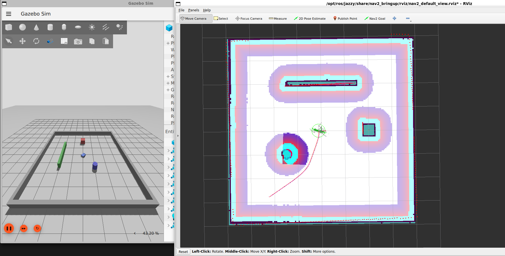
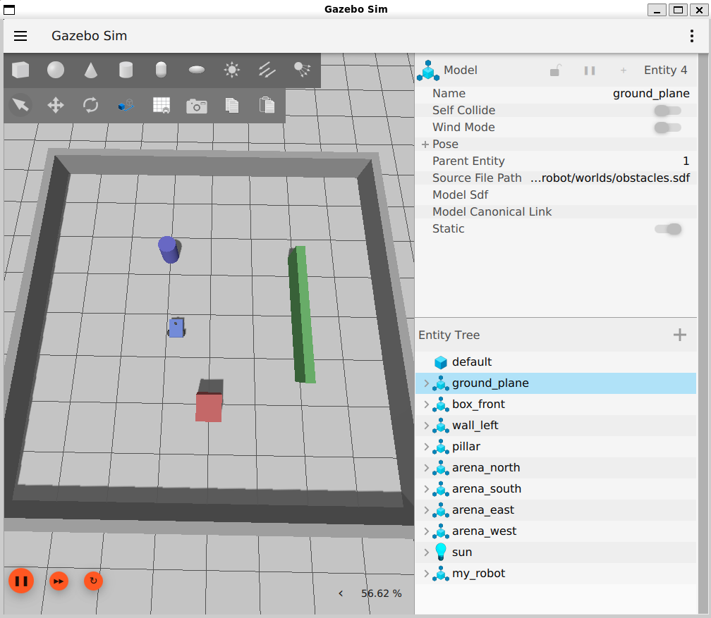
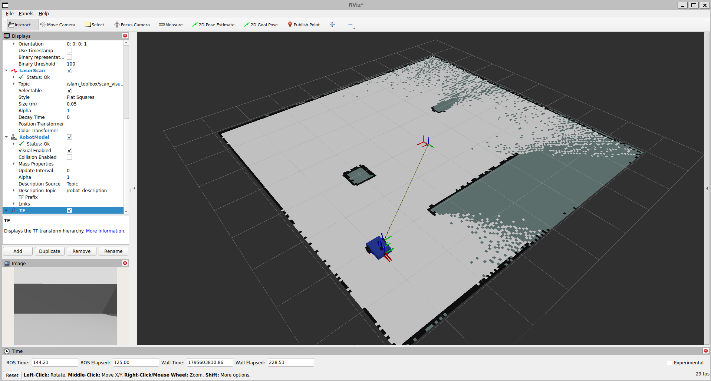
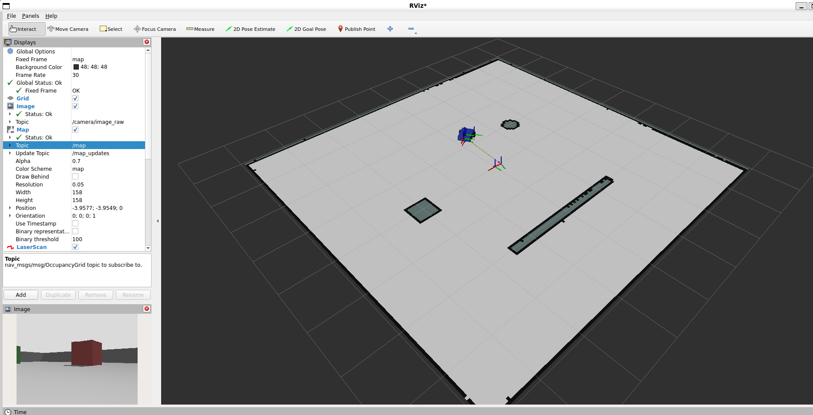

# ROS 2 + Gazebo Mobile Robot

A differential drive robot built from scratch in **ROS 2 Jazzy** and **Gazebo Harmonic**: robot description, sensors, closed loop control, obstacle avoidance, SLAM mapping and autonomous navigation with Nav2.

Built as a structured learning project by an automotive **Verification & Validation engineer** moving into robotics, with a focus on understanding *why* things work and *how they fail*.



| Robot in the Gazebo arena | SLAM: mapping in progress | SLAM: finished map |
|---|---|---|
|  |  |  |

<!-- Demo GIF to add later:

-->

---

## Highlights

- **Robot model in URDF/xacro:** differential drive base, 2D lidar and camera, parameterized with xacro properties and macros (one source of truth for dimensions and plugin values)
- **Gazebo Harmonic simulation:** custom obstacle arena, DiffDrive and JointStatePublisher plugins, ROS ↔ Gazebo bridge
- **Own controllers in Python (rclpy):**
  - go to goal with odometry feedback, state machine and P control, including a recovery rule
  - enable/disable **service** that actively commands a stop
  - reactive **obstacle avoidance** with lidar sectors and hysteresis
- **SLAM** with slam_toolbox: map of the arena saved as occupancy grid
- **Nav2** autonomous navigation on the saved map with a custom parameter file (automatic initial pose, robot specific footprint)
- **Engineering notes** on drift, failure modes and test observations (see below)

---

## Tech stack

| Area | Tools |
|---|---|
| Middleware | ROS 2 Jazzy (rclpy, topics, services, actions, parameters, launch) |
| Simulation | Gazebo Harmonic (gz sim 8), ros_gz_bridge, ros_gz_sim |
| Robot description | URDF, xacro, robot_state_publisher, TF2 |
| Navigation | slam_toolbox, Nav2 (AMCL, costmaps, planner, controller, behavior tree) |
| Visualization | RViz2 |
| Environment | Ubuntu 24.04 on Windows 11 (WSL2), Python 3.12 |

---

## Repository structure

```
.
├── docs/media/                Screenshots and demo GIF
├── my_robot/                  Gazebo robot (main project)
│   ├── config/                Nav2 parameter file
│   ├── launch/                display (RViz) and gazebo (full simulation) launch files
│   ├── maps/                  SLAM map of the arena (pgm + yaml)
│   ├── my_robot/              Python nodes
│   ├── rviz/                  RViz configuration
│   ├── urdf/                  Robot description (xacro)
│   └── worlds/                Gazebo arena with obstacles
└── my_turtle/                 ROS 2 fundamentals with turtlesim
    ├── launch/
    └── my_turtle/             Python nodes
```

### `my_robot` nodes

| Executable | What it does |
|---|---|
| `go_to_goal_gz` | Drives a list of goal points using `/odom`. TURN/DRIVE state machine, P control, recovery when off course. Goals and speed as parameters. |
| `goal_by_service_action` | Same controller plus an `/enable` service (`std_srvs/SetBool`) that pauses and resumes the robot by publishing an explicit stop. |
| `obstacle_avoider` | Reactive exploration with `/scan`: front/left/right sectors, turn towards free space, hysteresis between states. |

### `my_turtle` nodes (fundamentals)

| Executable | What it does |
|---|---|
| `circle_driver` | First publisher, open loop shapes by timing |
| `square_closed_loop` | Subscriber to pose, state machine, P control |
| `go_to_goal` | Drives to fixed target points with a recovery rule |
| `goal_by_param` | Same, with goals and speed as ROS parameters, started from a launch file |

---

## Architecture

```
                 ┌──────────────── Gazebo Harmonic ────────────────┐
                 │  arena world · DiffDrive · lidar · camera        │
                 └───────────────────────┬─────────────────────────┘
                                         │ ros_gz_bridge
        /cmd_vel (ROS → Gazebo)          │          /odom, /scan, /tf, /clock,
                 ▲                       │          /joint_states (Gazebo → ROS)
                 │                       ▼
   ┌─────────────┴─────────────┐   ┌───────────────────────┐
   │ my controller nodes        │   │ robot_state_publisher │ ← URDF/xacro
   │ or teleop or Nav2          │   └───────────────────────┘
   └────────────────────────────┘

TF tree:  map → odom → base_footprint → base_link → wheels / lidar_link / camera_link
          (AMCL/SLAM) (DiffDrive)       (robot_state_publisher)
```

---

## Getting started

### Prerequisites

Ubuntu 24.04 with ROS 2 Jazzy desktop, then:

```bash
sudo apt install -y \
  ros-jazzy-ros-gz ros-jazzy-xacro ros-jazzy-joint-state-publisher-gui \
  ros-jazzy-teleop-twist-keyboard ros-jazzy-turtlesim \
  ros-jazzy-slam-toolbox ros-jazzy-navigation2 ros-jazzy-nav2-bringup
```

### Build

```bash
mkdir -p ~/ros2_ws && cd ~/ros2_ws
git clone https://github.com/shamsherlala/ros2-gazebo-mobile-robot.git src
colcon build --symlink-install
source install/setup.bash
```

### Run

**Robot in Gazebo, drive with the keyboard**
```bash
ros2 launch my_robot gazebo.launch.py
ros2 run teleop_twist_keyboard teleop_twist_keyboard        # second terminal
```

**Own controllers** (second terminal, Gazebo running)
```bash
ros2 run my_robot go_to_goal_gz --ros-args -p use_sim_time:=true
ros2 run my_robot obstacle_avoider --ros-args -p use_sim_time:=true
ros2 run my_robot goal_by_service_action --ros-args -p use_sim_time:=true
ros2 service call /enable std_srvs/srv/SetBool "{data: false}"   # pause
```

**SLAM: build a map**
```bash
ros2 launch slam_toolbox online_async_launch.py use_sim_time:=true
ros2 run rviz2 rviz2 -f map --ros-args -p use_sim_time:=true
ros2 run nav2_map_server map_saver_cli -f ~/ros2_ws/src/my_robot/maps/arena
```

**Nav2: autonomous navigation on the saved map**
```bash
ros2 launch nav2_bringup bringup_launch.py use_sim_time:=True \
  map:=$HOME/ros2_ws/src/my_robot/maps/arena.yaml \
  params_file:=$HOME/ros2_ws/src/my_robot/config/nav2_params.yaml
ros2 run rviz2 rviz2 -d /opt/ros/jazzy/share/nav2_bringup/rviz/nav2_default_view.rviz \
  --ros-args -p use_sim_time:=true
```
Then use **Nav2 Goal** in RViz, or send the action directly:
```bash
ros2 action send_goal /navigate_to_pose nav2_msgs/action/NavigateToPose \
  "{pose: {header: {frame_id: map}, pose: {position: {x: -2.5, y: 2.5}, orientation: {w: 1.0}}}}" --feedback
```

**Turtlesim fundamentals**
```bash
ros2 launch my_turtle turtle_goals.launch.py
```

---

## Engineering notes (V&V perspective)

Observations from testing, written the way I would document findings on a test bench:

| Observation | Root cause | Takeaway |
|---|---|---|
| Robot reports "goal reached" while being ~0.5 m off in Gazebo after many laps | Odometry is dead reckoning and drifts with wheel slip | Validate against **independent ground truth**, not the system's own report |
| Disabling the controller by "not publishing" lets the robot keep driving | The motor plugin holds the last command | "Stop sending" ≠ "send stop". Publish an explicit stop (plus watchdog in real systems) |
| Robot orbits a missed goal forever | DRIVE state had no exit when the goal ended up beside the robot | Every state needs a way out: recovery rule |
| Robot creeps towards obstacles for 20+ seconds | P control target equal to the switch threshold | Aim the controller beyond the threshold |
| State flickers near a distance threshold | Same value used to enter and leave a state | Hysteresis (0.6 m / 0.9 m) |
| Robot spins forever with a fixed "free space" threshold | Exit condition the environment could not satisfy | Make conditions relative to the environment and add timeouts |
| Changing wheel radius in one place only would corrupt odometry by 40% | Duplicated constants between model and plugin | One source of truth via xacro properties |
| Nav2 aborts at startup | AMCL had no initial pose, so the `map` frame never appeared | Configure the initial pose in the params file |

---

## Known limitations

- Reactive obstacle avoidance tends to follow walls in a rectangular arena; proper exploration needs map based planning.
- Tuned for a laptop with integrated graphics (low camera resolution, optional headless Gazebo). Real time factor around 50 to 80%.
- No automated tests yet (see roadmap).

---

## Roadmap

- [ ] Automated scenario tests: "robot reaches goal within X cm and Y s" with pytest and launch_testing
- [ ] Continuous integration with GitHub Actions
- [ ] Single launch file for simulation + Nav2
- [ ] Next project: robot arm with ros2_control and MoveIt 2

---

## About

**Shamsher Lala**, automotive software V&V engineer (HIL/SIL testing, ECU integration, CAN, SOME/IP, UDS, Python/pytest) building skills in robotics and physical AI.

- GitHub: [shamsherlala](https://github.com/shamsherlala)
- LinkedIn: [shamsherlala](https://www.linkedin.com/in/shamsherlala)

## License

Apache 2.0
